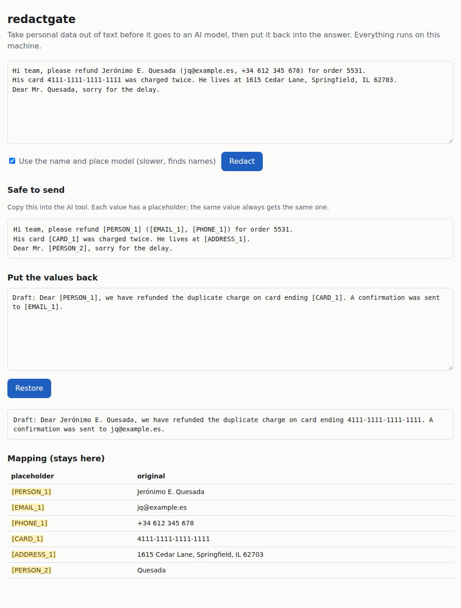

# redactgate

Take personal data (names, emails, card numbers, IBANs, addresses) out of text before it goes to ChatGPT or Claude, and put it back into the answer.
Each value becomes a placeholder such as `[PERSON_1]`, so the model still sees who did what; the mapping never leaves your machine. Runs locally on CPU.
On a synthetic finance benchmark it masks **84.1% of personal values in English** (Microsoft Presidio's defaults: 52.7%), but 24.0% of documents still leak at least one value, so a person should check the output.



## Results

[Gretel's synthetic_pii_finance_multilingual](https://huggingface.co/datasets/gretelai/synthetic_pii_finance_multilingual)
(Apache-2.0): synthetic financial documents (loan forms, SWIFT messages,
contracts, emails) with labelled personal data. Test split; rules were tuned
on the train split only. A labelled value counts as masked when at least 80%
of its characters are covered.

| English test (2,891 documents) | values masked | documents with any leak | precision (lower bound) |
|---|---|---|---|
| **redactgate, this version** | **84.1%** (6900/8205) | **24.0%** | 65.1% |
| redactgate, previous version | 83.2% (6823/8205) | 25.7% | 64.4% |
| Microsoft Presidio 2.2.366, default config | 52.7% (4322/8205) | 64.4% | 29.1% |
| redactgate, hand audit of 100 masks (earlier version, English test documents) | | | about 88% (estimate) |

Test figures for "this version" are for commit `354a317`. A code review after
the test run found ordinary text the new address patterns masked ("Launchpad 3",
"Version 2 Canale Today", a signature line after an address); the fixes were
measured on dev only and the test split was not run again. On dev they cost
0 to 2 addresses per language (-0.0 to -0.4 points); see
[docs/leak-analysis.md](docs/leak-analysis.md).

| test split (about 450 documents each) | values masked, previous -> **this version** | documents with any leak | precision (lower bound) |
|---|---|---|---|
| German | 67.8% -> **72.8%** (839/1152) | 43.5% -> 37.5% | 63.1% -> 64.0% |
| French | 69.6% -> **74.2%** (960/1293) | 44.7% -> 37.7% | 69.7% -> 70.5% |
| Spanish | 72.3% -> **75.8%** (1026/1353) | 39.5% -> 34.9% | 67.5% -> 67.6% |
| Italian | 68.0% -> **71.5%** (940/1315) | 45.5% -> 41.5% | 69.8% -> 70.2% |
| Dutch | 66.3% -> **71.8%** (887/1236) | 44.9% -> 38.9% | 59.8% -> 63.1% |

- **Real precision is higher than the lower bound.** The labels are
  incomplete, so the lower bound counts real personal data the labels missed
  as errors. A hand check of 100 masks outside any label, on an earlier
  version, found half of them were real personal data, which puts precision
  at about 88%; see the precision audit under
  [How well it works](#how-well-it-works).
- **It is not safe as the only control.** 24.0% of English test
  documents (34.9-41.5% in the other languages) still had at least one
  labelled value left in. Use it to cut how much personal data leaves, with a
  person reading the redacted text before it is sent.
- What changed in this version: [address patterns](docs/leak-analysis.md),
  chosen from a leak analysis on the dev splits.

## Quick start

```bash
git clone <this repository> && cd redactgate
uv venv && uv pip install -r requirements.txt   # or: python -m venv .venv && .venv/bin/pip install -r requirements.txt
source .venv/bin/activate
python scripts/demo.py                          # first run downloads the NER model (about 1 GB)
```

`scripts/demo.py` redacts a made-up customer email, shows what would be sent
to the model, a model answer (written by hand for the demo; no API is
called), and the answer with the real values put back. Its output:

```text
== 1. Original email (stays on your machine)

From: Daniel Okafor <d.okafor@example.com>
Subject: Refund for double charge

Hi, I was charged twice for my March invoice on card 4111 1111 1111 1111.
Please refund the second payment to my account GB82 WEST 1234 5698 7654 32.
My address is 742 Maple Avenue, Springfield, IL 62704 and you can reach me
on +1 (217) 555-0148. Thanks, Daniel Okafor

== 2. What is sent to the model

From: [PERSON_1] <[EMAIL_1]>
Subject: Refund for double charge

Hi, I was charged twice for my March invoice on card [CARD_1].
Please refund the second payment to my account [IBAN_1].
My address is [ADDRESS_1] and you can reach me
on [PHONE_1]. Thanks, [PERSON_1]

== 3. Mapping (stays on your machine)

[PERSON_1]     Daniel Okafor
[EMAIL_1]      d.okafor@example.com
[CARD_1]       4111 1111 1111 1111
[IBAN_1]       GB82 WEST 1234 5698 7654 32
[ADDRESS_1]    742 Maple Avenue, Springfield, IL 62704
[PHONE_1]      +1 (217) 555-0148

== 4. Model answer (made up for the demo)

Dear [PERSON_1],

Thank you for contacting us. We have confirmed the duplicate charge on card
[CARD_1] and refunded the second payment to [IBAN_1]. You will receive a
confirmation at [EMAIL_1]; if anything is unclear we will call you on
[PHONE_1].

== 5. Answer with the real values restored

Dear Daniel Okafor,

Thank you for contacting us. We have confirmed the duplicate charge on card
4111 1111 1111 1111 and refunded the second payment to GB82 WEST 1234 5698 7654 32. You will receive a
confirmation at d.okafor@example.com; if anything is unclear we will call you on
+1 (217) 555-0148.
```

Then the web page and JSON API: `uvicorn redactgate.app:app --port 8840`
(see [Run it](#run-it)).

## How it works

```text
                ┌─ 1. patterns + validators ─┐
 text ──────────┤                            ├─ 3. merge ─ 4. propagate ─ 5. placeholders ──> redacted text ──> LLM
                └─ 2. NER model (PER/LOC)  ──┘                                  │                                  │
                                                                         mapping (local)                         answer
                                                                                └─────────── 6. restore ───────────┘
```

1. **Patterns with validators** (`find_patterns` in `redactgate/detect.py`):
   regular expressions for emails, phones, cards, IBANs, SSNs, IPs, SWIFT
   codes, secrets, IDs, dates of birth and street addresses. Where a checksum
   exists it must pass: Luhn for cards, mod-97 for IBANs, ABA for routing
   numbers. Others need a label word next to them ("passport no.",
   "password:", "Geburtsdatum").
2. **NER model** (`find_entities`): `Davlan/xlm-roberta-base-ner-hrl` on CPU
   finds people and places in de/en/es/fr/it/nl. Spans are widened to whole
   words; a place is kept only next to a number (part of an address), and
   role words ("Lender") are dropped.
3. **Merge** (`merge`): overlapping spans are joined and the more specific
   label wins (a card number inside a "name" is a card number); address
   pieces split by a comma become one address.
4. **Propagate** (`propagate`): every other copy of a found value in the
   document is masked too, so a name found once is masked everywhere.
5. **Placeholders** (`redact` in `redactgate/redact.py`): the same value
   always gets the same placeholder (`[PERSON_1]`), and a surname on its own
   points to the full name (`[PERSON_1_LAST]`). The mapping placeholder ->
   value stays with the caller.
6. **Restore** (`restore`): placeholders in the model's answer are swapped
   back, including ones the model wrote without brackets (`PERSON_1`).
   Placeholders the model made up are left as they are.

## What it finds

- **Patterns with checks:** emails, phone numbers, card numbers (Luhn check),
  IBANs (mod-97 check), US routing numbers (ABA checksum, or after the words
  "routing number"), SSNs, IPv4/IPv6, SWIFT/BIC codes, CVVs, passwords and
  API keys, passport/licence/customer/employee IDs after their label, dates of
  birth, coordinates, street addresses with city/state/postcode (also over
  several lines).
- **Names and places:** `Davlan/xlm-roberta-base-ner-hrl` (AFL-3.0, about
  1 GB, CPU; covers German, English, Spanish, French, Italian, Dutch,
  Portuguese and others) by default, or `dslim/bert-base-NER` (MIT, English
  only). Spans are widened to whole words. A place is only masked when it is
  part of a street address; a city or country on its own is left in.
- **Repeats:** once a value is found, every other copy of it in the document
  is masked with the same placeholder.

Dates, times, amounts and company names are left in by design. Company names
are detected (`ORG`) but not masked by default.

## How well it works

Full results per label are in `docs/results-*.md` (`en`, `de`, ... = language;
`dev`/`test` = split; `multi-model` = default setup).

**History on the English test split.** Rules were first tuned on the first
500 documents of the train split ("dev"); the 2,891-document test split was
run at the end of each round.

| split | method | values masked | characters masked | documents with any leak | precision (lower bound) |
|---|---|---|---|---|---|
| dev (500) | patterns + English NER model | 79.3% (1118/1409) | 85.6% | 32.2% | 66.6% |
| test (2,891) | patterns only | 55.0% (4516/8205) | 63.3% | 58.0% | 65.1% |
| test (2,891) | patterns + English NER model | 76.0% (6239/8205) | 83.0% | 37.0% | 65.6% |
| test (2,891) | patterns + multilingual NER model (default) | 81.8% (6715/8205) | 87.2% | 27.9% | 64.7% |
| test (2,891) | + keyed patterns (previous version) | 83.2% (6823/8205) | 88.6% | 25.7% | 64.4% |
| test (2,891) | **+ address patterns (this version)** | **84.1% (6900/8205)** | **89.4%** | **24.0%** | 65.1% |
| test (2,891) | Microsoft Presidio analyzer 2.2.366, default config, spaCy 3.8 `en_core_web_lg` | 52.7% (4322/8205) | 62.0% | 64.4% | 29.1% |

Per type on test (this version): names 82%, street addresses 92%
(previous version 89%), emails 93%, phone numbers 91%, card numbers 93%, IBANs
97%, SWIFT 100%, IPs 98-100%; weakest are surnames on their own (39%),
employee and customer IDs (52%), driver's licences and account PINs (51%),
usernames (53%) and CVVs (54%). Full table:
`docs/results-en-test-multi-model.md`. Speed: 233 ms per document on CPU with the model for this
English run, on a machine busy with other jobs (the other languages took
123-136 ms; the earlier English-model run took 152 ms). Patterns alone take
about 1 ms per document.

**How often the test split was looked at.** This version's run is the
fifth look at the English test split (patterns only, English model,
multilingual model, previous version, this version) and the third at the
other languages; Presidio was also run once on the English test split.
Each change was decided on dev before the test run, and no tuning was done
after a test run; the test split was run once for this version, after the
change was final. Against the previous version, nothing got worse on test
except one Italian name (411 instead of 412 of 576 masked).

**Other languages.** EU businesses are the obvious buyers (GDPR), so the
same evaluation was run on the dataset's German, French, Spanish, Italian and
Dutch splits. Dev is the first 200 train documents per language; each test
split has about 450 documents. Additions for these languages: street-name-first
and street-suffix address forms ("Rue de la Paix",
"Schnellstraße 12, 45678 Berlin", "Åkervägen"), European phone formats,
"IBAN:"-keyed IBANs, date-of-birth and name labels in each language
("Geburtsdatum", "né(e) le", "Nom", "Herr", "Monsieur").

| language | dev, English setup | dev, multilingual model | dev, + European rules | test, first run | test, previous version | **test, this version** |
|---|---|---|---|---|---|---|
| German | 44.4% | 53.3% | 67.2% | 66.5% | 67.8% | **72.8%** (839/1152) |
| French | 37.3% | 50.8% | 68.2% | 68.5% | 69.6% | **74.2%** (960/1293) |
| Spanish | 45.9% | 56.7% | 66.5% | 71.8% | 72.3% | **75.8%** (1026/1353) |
| Italian | 39.1% | 50.1% | 70.1% | 66.9% | 68.0% | **71.5%** (940/1315) |
| Dutch | 41.3% | 53.8% | 64.2% | 65.3% | 66.3% | **71.8%** (887/1236) |
| English | 79.3% | 83.0% | 84.0% | 81.8% \* | 83.2% | **84.1%** (6900/8205) |

\* The first English test run with the multilingual model was the second
run on the English test split (the first, with the English model, gave
76.0%). Swedish was not tried: the model does not cover it.

**Previous version (dev only, then one test run).** Patterns for API keys
(long mixed-case tokens), passwords after "password ... be:", usernames after
"User Name:", PINs, IDs with lowercase letters, and routing numbers with
words between the label and the number. Dev: English 84.0% -> 85.1%, German
67.6% -> 68.4%, French 68.2% -> 69.8%, Spanish 66.5% -> 67.1%, Italian 70.1%
-> 71.0%, Dutch 65.0% -> 65.6%; the precision lower bound moved -1.2 (en),
-1.2 (de), +0.9 (fr), -0.4 (es), +0.3 (it) and -2.9 (nl) points. The test
gains that followed (+0.5 to +1.4 points) matched the dev gains.

**This version (dev only, then one test run).** A leak analysis of the six
dev splits ([docs/leak-analysis.md](docs/leak-analysis.md)) grouped every
missed value by cause. Addresses were the largest single cause (180 of 553
leaking dev documents): Spanish and Italian street types ("Cuesta",
"Incrocio"), Dutch and Swedish suffixes ("-pad", "-torget"), "Roggestr. 5",
"Rue de l'Espoir", and English addresses written over several lines. Fixing
those raised dev recall by 1.8 (English) to 5.6 (German) points; the precision
lower bound rose or stayed level except French (-0.5). The second cause,
names the model tags as companies, was tried and dropped: it lowered the
precision lower bound on every dev split. Other groups are labelled template
placeholders ("[Your Name]"), names in CSV cells, and ID numbers with no label
word next to them.

**Review fixes after the test run (dev only).** The line after a street is now
only taken when it carries a postcode, a US/Canadian/UK code or a country (or
a postcode line follows), and the last line only when it is a country; "-pad"
and "vial" were removed from the street types; for the newly added street
types that are also ordinary words ("Borgo", "Canale"), a number after a
capitalised word ("Section 4 Borgo") no longer starts an address unless a
postcode comes after a comma. Dev, values masked: English 86.9% -> 86.8%,
German 74.0% -> 74.0%, French 74.5% -> 74.2%, Spanish 71.3% -> 70.9%, Italian
75.2% -> 75.0%, Dutch 69.6% -> 69.2%; the precision lower bound stayed level
or rose by up to 0.2 points. The values lost are real addresses of those forms
("Matthijspad 658", "76 Vial Albina Gallart"); the test figures above were
measured before these fixes.

**Against Presidio.** Out of the box, Presidio masks about as many names (72%
vs 74% for the English-model setup) but far fewer street addresses (12% vs
82%), SWIFT codes, passwords and bank account numbers. Its precision lower
bound is lower because by default it also masks every date, time, city and
country. It is faster (27 ms vs 152 ms per document for the English-model
setup). This compares defaults: Presidio is built to take custom recognizers,
and adding address and banking ones would close much of the gap. Run:
`python scripts/evaluate.py --split test --detector presidio` from a venv with
`presidio-analyzer` and `en_core_web_lg`.

**Precision audit.** The labels are incomplete. I audited 100 random masks
(from 300 English test documents, an earlier version) that touch no labelled
value: 50 were real personal data the labels missed (names in chat
transcripts, phone numbers, SSNs in CSV rows, account numbers), 50 were not
(city/country names in company addresses, role words like "Lender",
capitalised ordinary words, numbers in tables). Such masks are 24% of masked
characters, so about 12% of masked characters are false positives:
**estimated precision about 88%**. One annotator (me), 100 items: treat it as
a rough estimate. The audit is in `docs/precision-audit.json`. Afterwards,
role words and a short list of ordinary words were filtered from the model's
output (English dev: recall unchanged at 84.0%, lower bound 64.9% -> 65.8%).

**Caveats.**

- **It is not safe as the only control.** See the leak rate above. The page
  shows the redacted text for a person to read before it is sent.
- **Synthetic data.** Card and routing numbers in the dataset often fail
  their checksums, so the tool also accepts them when a label word ("card",
  "routing number") is next to them. Real documents may behave differently.
- **One methodology slip:** the very first patterns-only run (before the dev
  split existed) was on the test split. All tuning after that used dev only.
- A shortened name ("Mr. Quesada" after "Jerónimo E. Quesada") becomes
  `[PERSON_1_LAST]`, so the model can tell it is the same person as
  `[PERSON_1]`. Restore also accepts placeholders a model wrote without
  brackets. Without the model (patterns only), first names are often missed.
- The screenshot above predates `[PERSON_1_LAST]`: it shows the surname as
  `[PERSON_2]`.

## Run it

```bash
uv venv && uv pip install -r requirements.txt -r requirements-dev.txt
source .venv/bin/activate
pytest -q -m "not model"                   # fast tests, no model download (what CI runs)
pytest -q                                  # also the test that runs the NER model
uvicorn redactgate.app:app --port 8840     # page at http://localhost:8840
```

JSON API, to put in front of any model:

```bash
curl -s localhost:8840/api/redact -H 'content-type: application/json' -d '{"text": "Email ana@lima.pt"}'
# {"redacted": "Email [EMAIL_1]", "mapping": {"[EMAIL_1]": "ana@lima.pt"}, ...}
curl -s localhost:8840/api/restore -H 'content-type: application/json' \
  -d '{"text": "Wrote to [EMAIL_1]", "mapping": {"[EMAIL_1]": "ana@lima.pt"}}'
```

Files: the page takes a .pdf (with a text layer; scans are refused, there is
no OCR), .docx (paragraphs and tables) or .txt upload, and so does
`POST /api/redact-file` (multipart, field `file`). Output is redacted text,
not a redacted PDF.

Reproduce the measurements (other languages: `German`, `France`, `Spanish`,
`Italian`, `Dutch` file prefixes and `--lang de|fr|es|it|nl`):

```bash
mkdir -p data/raw
curl -L -o data/raw/en_train.parquet https://huggingface.co/datasets/gretelai/synthetic_pii_finance_multilingual/resolve/main/data/English_train-00000-of-00001.parquet
curl -L -o data/raw/en_test.parquet  https://huggingface.co/datasets/gretelai/synthetic_pii_finance_multilingual/resolve/main/data/English_test-00000-of-00001.parquet
python scripts/evaluate.py --split dev          # first 500 train documents
python scripts/evaluate.py --split test         # run once
```

## Browser extension (`extension/`)

The product shape: paste into ChatGPT, Claude or Gemini and the text is
redacted before it lands in the box; select the AI's answer and press
"Restore selection" to copy it with the real values back in.

- The extension calls the redactgate service on your own computer
  (`127.0.0.1:8840`) from its background worker; the chat site never sees the
  service or the mapping. The mapping lives only in that tab's memory.
- If the service is not running, the paste is **blocked** with a note,
  rather than letting the unredacted text through.

Install: start the service (`uvicorn redactgate.app:app --port 8840`), then
Chrome > Extensions > Developer mode > Load unpacked > `extension/`.

Tests (`cd extension && npm install && npm test`, 4 tests): `content.js` in
headless Chromium on a fake chat page served at `https://chatgpt.com`
(intercepted, nothing reaches the real site), calling the real local
service: paste into a textarea and into a rich-text editor, paste blocked
when the service is down, restore of a selected answer. `node
test/load-extension.js` loads the real unpacked extension and pastes through
its background worker. Not tested on the real ChatGPT, Claude or Gemini
pages, whose editors may handle inserted text differently.

## Not done

- No direct call to Claude or another model; it's copy and paste, or the
  JSON API. (No API key was available when this was built.)
- Swedish and other languages outside the model are untested.
- Output is text: a redacted PDF or Word file with the layout kept is not built.
- Presidio with custom recognizers was not tried; only its defaults.
- Names the NER model tags as companies are still missed (see
  `docs/leak-analysis.md`).

## Licences

- Code: MIT (`LICENSE`).
- NER models, downloaded from Hugging Face on first use, not included:
  `Davlan/xlm-roberta-base-ner-hrl` (AFL-3.0, the default) and
  `dslim/bert-base-NER` (MIT).
- Evaluation data: Gretel's `synthetic_pii_finance_multilingual`
  (Apache-2.0), downloaded by the commands above, not included.
  `docs/precision-audit.json` quotes short snippets of it; all of it is
  synthetic.
- Extension tests use Playwright (Apache-2.0), installed by `npm install`.
